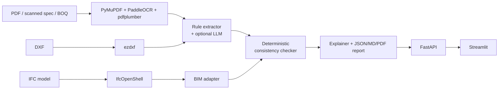

# 🏗️ BuildDoc AI

**Construction drawing, specification & BIM consistency checker.**

BuildDoc AI reads construction documents (scanned specifications, drawings, Bills of
Quantities) and BIM models (IFC), extracts engineering parameters with full source
references, and flags inconsistencies between them using **deterministic validation**.
An LLM (Qwen2.5 or GPT) is optional and is used only to help read messy text and to
explain findings, never to decide whether values match.


---

## What it does

| Parameter | Structural spec | BIM model | Result |
|---|---|---|---|
| External wall thickness | 200 mm (p.1) | 200 mm (`2J$kEW1`) | ✅ Match |
| Concrete grade | M25 (p.1) | M30 (`2J$kEW1`) | ❌ Conflict · critical |
| Main door width | 1000 mm (p.1) | 900 mm (`4D$oor1`) | ❌ Conflict · medium |
| Slab thickness | 150 mm (p.1) | 150 mm (`3S$lab1`) | ✅ Match |

Every row links back to a PDF page, table row, or IFC element GlobalId. Conflicts, missing
values and low-confidence matches are routed to **human review**.

## Architecture



Full design, data model and sequence diagrams: **[docs/ARCHITECTURE.md](docs/ARCHITECTURE.md)**

## Tech stack

| Layer | Technology |
|---|---|
| PDF text | PyMuPDF |
| OCR (scanned pages only) | PaddleOCR |
| Tables | pdfplumber, pandas |
| BIM | IfcOpenShell |
| CAD | ezdxf |
| LLM (optional) | Qwen2.5 via Ollama/vLLM, or OpenAI (any OpenAI-compatible endpoint) |
| Schemas & validation | Pydantic v2 |
| API | FastAPI |
| UI | Streamlit |
| Reports | reportlab (PDF), Markdown, JSON |
| Packaging | Docker, docker-compose, GitHub Actions |

## Quick start

```bash
git clone https://github.com/<your-username>/BuildDoc-AI.git
cd BuildDoc-AI
cp .env.example .env

# Option A: Docker
docker compose up --build          # API :8000, dashboard :8501

# Option B: local
python -m venv .venv && source .venv/bin/activate
make install
make sample                        # downloads a public IFC model into data/bim_models
make api                           # http://localhost:8000/docs
make ui                            # http://localhost:8501   (second terminal)
```

### CLI

```bash
python -m app.pipeline.orchestrator data/specifications/spec.pdf data/bim_models/sample.ifc
# writes outputs/report.json and outputs/report.md
```

### Enable the LLM (optional)

```bash
ollama pull qwen2.5:7b-instruct
# in .env
BUILDDOC_LLM_PROVIDER=openai
BUILDDOC_LLM_BASE_URL=http://localhost:11434/v1
BUILDDOC_LLM_MODEL=qwen2.5:7b-instruct
```

## API

| Method | Endpoint | Description |
|---|---|---|
| POST | `/api/v1/documents` | Upload + parse a PDF / XLSX / IFC / DXF |
| GET | `/api/v1/documents/{id}` | Parsed content |
| POST | `/api/v1/analyses` | Compare documents → review report |
| GET | `/api/v1/analyses/{id}/export?fmt=json\|md\|pdf` | Download report |
| PATCH | `/api/v1/analyses/{id}/findings/{fid}` | Approve / reject a finding |

Interactive docs at `http://localhost:8000/docs`.

## Project structure

```
app/
├── api/          REST endpoints
├── core/         settings, logging, store
├── ocr/          PDF text, PaddleOCR, tables
├── bim/          IFC and DXF parsers
├── extraction/   schemas, parameter catalogue, rule + LLM extractors, BIM adapter
├── validation/   deterministic consistency checker
├── reporting/    explanations, JSON / Markdown / PDF reports
└── pipeline/     orchestrator (also a CLI)
frontend/         Streamlit dashboard
tests/            unit, end-to-end and API tests
docs/             architecture & implementation plan
```

## Testing

```bash
make dev && make test
```

The test suite runs without OCR/BIM libraries (they are imported lazily), using a text
specification fixture and a synthetic BIM model with deliberate conflicts.

## Design decisions

- **Python decides, LLM explains.** Verdicts are reproducible and auditable.
- **Provenance everywhere.** Every value has a `SourceRef` (page, bbox, table row, IFC GlobalId).
- **Single parameter catalogue.** Adding a new check is one entry in `app/extraction/catalog.py`.
- **LLM output is verified.** Proposed values must quote text that exists on the cited page.
- **Offline by default.** With `LLM_PROVIDER=none` the full pipeline runs without any API.

## Roadmap

See [docs/IMPLEMENTATION_PLAN.md](docs/IMPLEMENTATION_PLAN.md) and the limitations table in
[docs/ARCHITECTURE.md](docs/ARCHITECTURE.md#8-known-limitations--next-steps).

## License

MIT
