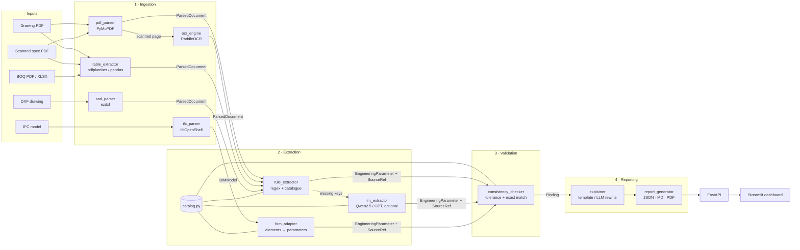
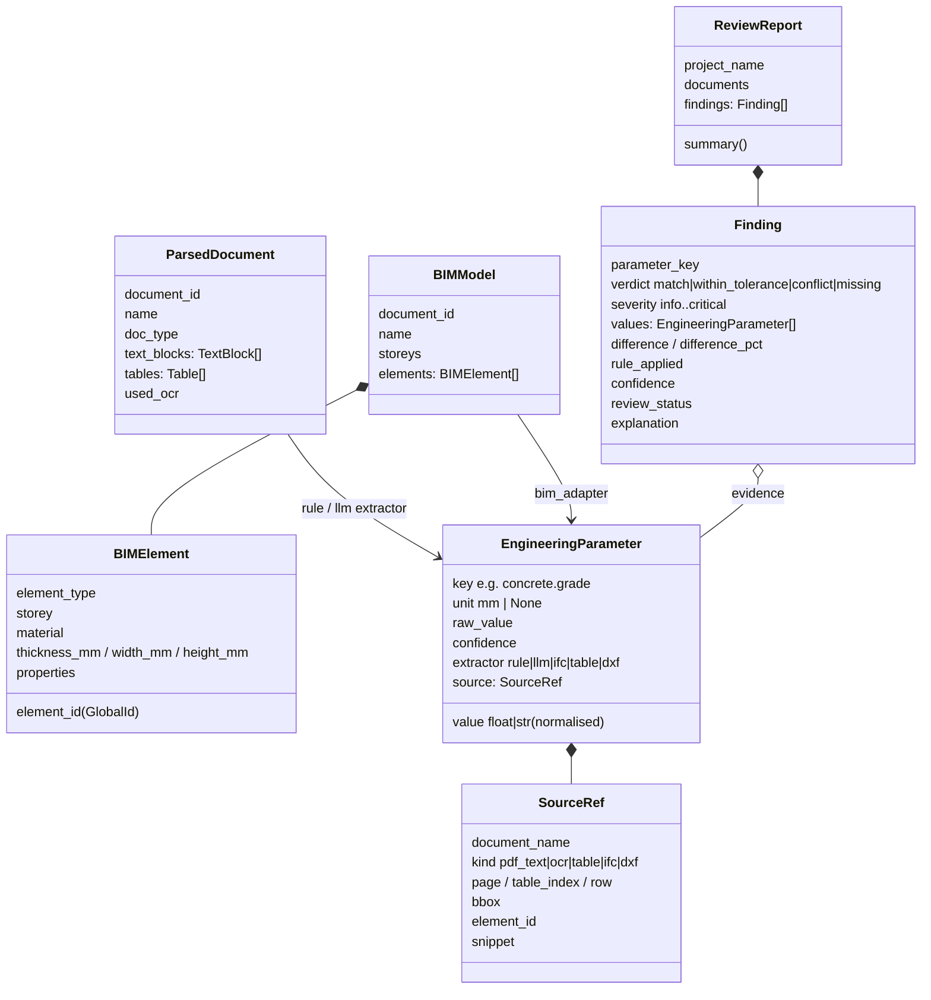
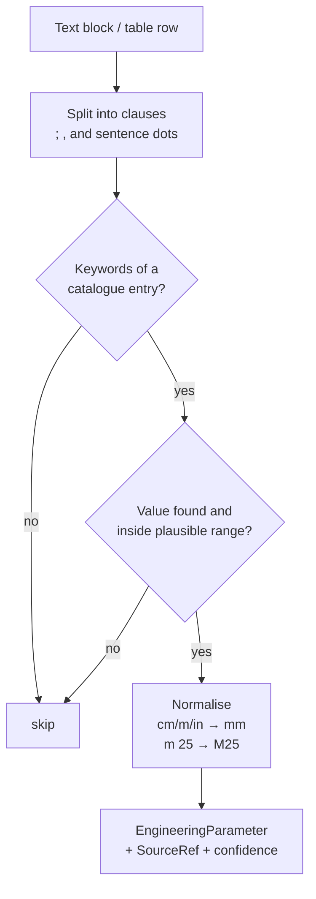
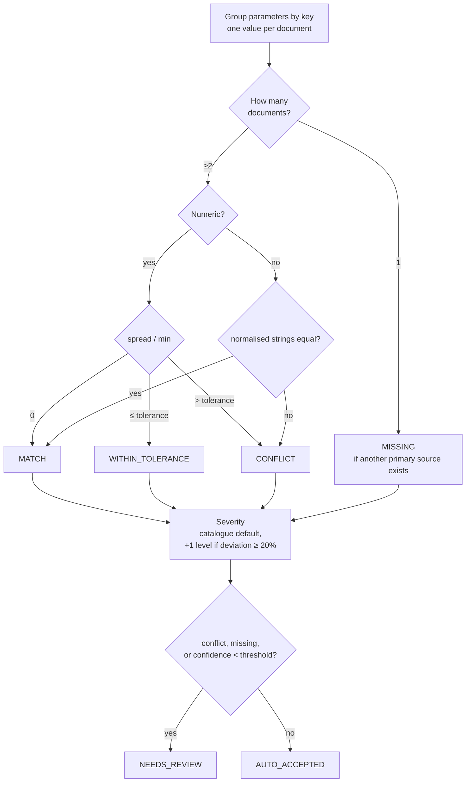
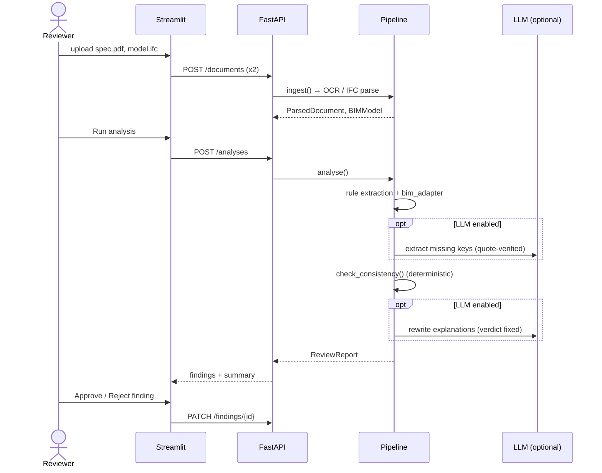

# Architecture & Design

## 1. Problem

A construction project is described by several documents written by different teams:
a structural specification (often a scanned PDF), drawings, a Bill of Quantities, and a
BIM model. They drift apart. A spec says **M25** concrete while the BIM model says **M30**;
the spec says the main door is **1000 mm** while the model has **900 mm**. Finding these by
hand is slow and error-prone.

BuildDoc AI reads all of them, turns every stated value into a typed, traceable fact, and
compares the facts with **deterministic rules**. An LLM is optional and only helps with
*reading* messy text and *explaining* findings; it never decides whether two values match.

## 2. Design principles

| # | Principle | Why it matters |
|---|---|---|
| P1 | **Python decides, LLM explains** | Engineering verdicts must be reproducible and auditable. |
| P2 | **Every value carries provenance** (`SourceRef`) | A reviewer must be able to jump to the page / table row / IFC GlobalId. |
| P3 | **One parameter catalogue** (`catalog.py`) | Adding a check is one entry; extractor, LLM prompt, BIM adapter and checker all read it. |
| P4 | **Works fully offline** | `LLM_PROVIDER=none` gives a complete, deterministic pipeline (good for CI and demos). |
| P5 | **Heavy deps are lazy-imported** | PaddleOCR / IfcOpenShell load only when needed; tests run on a plain Python install. |
| P6 | **Human-in-the-loop by default** | Conflicts, missing values and low-confidence matches are routed to review. |

## 3. System overview



## 4. Data model

All stages talk through Pydantic models in `app/extraction/schemas.py`.



### Canonical parameter keys (v0.1)

| Key | Kind | Conflict severity |
|---|---|---|
| `wall.external.thickness` | length (mm) | high |
| `wall.internal.thickness` | length (mm) | medium |
| `slab.thickness` | length (mm) | high |
| `door.main.width` / `door.main.height` | length (mm) | medium |
| `storey.height` | length (mm) | medium |
| `concrete.grade` | grade (M25, C25/30) | critical |
| `rebar.grade` | grade (Fe500D, B500B) | critical |

## 5. Component design

### 5.1 Ingestion (`app/ocr`, `app/bim`)

**Native text vs OCR, decided per page.** `pdf_parser` reads each page with PyMuPDF. If a
page has fewer than `OCR_MIN_CHARS_PER_PAGE` characters of real text, it is treated as a
scan: rendered at `OCR_DPI` and passed to PaddleOCR. This keeps OCR cost to scanned pages
only, and native text keeps confidence 1.0 while OCR blocks carry PaddleOCR's score.

**Tables.** pdfplumber for PDFs, pandas for Excel BOQs. Rows become `Table` objects so the
extractor can cite `table N, row M`.

**IFC.** `ifc_parser` walks `IfcWall`, `IfcSlab`, `IfcBeam`, `IfcColumn`, `IfcDoor`,
`IfcWindow`. For each element it reads:
- storey via spatial containment (`get_container` → `IfcBuildingStorey`)
- material via `get_material` (for layer sets, the thickest layer is taken as structural)
- quantities from `Qto_*BaseQuantities` (Width, Depth, Height, NetVolume…)
- properties from `Pset_*` (e.g. `Pset_WallCommon.IsExternal`)

All lengths are converted to mm using the model's own unit scale
(`ifcopenshell.util.unit.calculate_unit_scale`), so a metre-based model and a mm-based
model compare correctly.

**DXF.** `cad_parser` reads TEXT/MTEXT annotations and DIMENSION measurements and emits a
`ParsedDocument`, so the same rule extractor reads CAD annotations.

### 5.2 Extraction (`app/extraction`)



- **Rule extractor** (always on). Keyword groups + regex + plausible ranges per parameter.
  Ranges reject OCR junk such as page numbers or drawing numbers.
- **LLM extractor** (optional). Fills only keys the rules missed. Guardrails:
  JSON output, catalogue-only keys, a **verbatim quote that must exist on the cited page**
  (otherwise dropped), and re-normalisation through the same deterministic normalisers.
- **BIM adapter.** A model has many walls and doors, so per key it takes the *modal* value,
  cites a representative GlobalId, and sets confidence `0.6 + 0.4 × (agreeing / total)`.
  A non-uniform model therefore lowers confidence and can push a match into review.
  Main door = widest door.

### 5.3 Validation (`app/validation/consistency_checker.py`)



- Grades are never "close": M25 vs M30 is always a conflict.
- Finding confidence = the *lowest* confidence among its evidence (weakest link).
- Findings are sorted worst-first so the report opens on what matters.

### 5.4 Reporting (`app/reporting`)

- `explainer.template_explanation` always produces a factual sentence with every value
  and its location.
- If an LLM is configured, it may rewrite conflict/missing explanations for readability.
  The prompt states the verdict as a fixed fact.
- Exports: JSON (full model, for integration), Markdown (GitHub / tickets), PDF
  (reportlab, colour-coded for reviewers).

### 5.5 API (`app/api/routes.py`)

| Method | Path | Purpose |
|---|---|---|
| GET | `/api/v1/health` | Liveness + LLM mode |
| POST | `/api/v1/documents` | Upload + parse one file (type inferred or given) |
| GET | `/api/v1/documents` | List parsed documents |
| GET | `/api/v1/documents/{id}` | Parsed text / tables / BIM elements |
| POST | `/api/v1/analyses` | Run extraction + validation on chosen documents |
| GET | `/api/v1/analyses/{id}` | Full review report |
| GET | `/api/v1/analyses/{id}/export?fmt=json\|md\|pdf` | Download report |
| PATCH | `/api/v1/analyses/{id}/findings/{fid}` | Human review: approve / reject + comment |

Storage is an in-memory `Store` (4-day scope). Its interface is two methods, so swapping in
SQLite or Postgres does not touch the routes.

### 5.6 Frontend (`frontend/streamlit_app.py`)

A thin client over the API with the four sections from the brief:

1. **Document Explorer**: upload, parse, choose documents to compare
2. **Extraction Results**: every extracted value with page / element id and evidence snippet
3. **Consistency Analysis**: verdict counts + side-by-side value table per document
4. **Review Report**: per-finding explanation and evidence, approve/reject buttons, JSON/MD/PDF download

## 6. Sequence: one analysis



## 7. Repository layout

```
BuildDoc-AI/
├── app/
│   ├── main.py                    # FastAPI app factory
│   ├── api/routes.py              # REST endpoints
│   ├── core/
│   │   ├── config.py              # env-driven settings (BUILDDOC_*)
│   │   ├── logging.py
│   │   └── store.py               # in-memory document/report store
│   ├── ocr/
│   │   ├── pdf_parser.py          # native text vs OCR per page
│   │   ├── ocr_engine.py          # PaddleOCR wrapper (lazy)
│   │   └── table_extractor.py     # pdfplumber + Excel
│   ├── bim/
│   │   ├── ifc_parser.py          # IfcOpenShell → BIMModel
│   │   └── cad_parser.py          # ezdxf → ParsedDocument
│   ├── extraction/
│   │   ├── schemas.py             # all Pydantic contracts
│   │   ├── catalog.py             # parameter catalogue (single source of truth)
│   │   ├── normalizers.py         # units + grades
│   │   ├── rule_extractor.py      # deterministic extractor
│   │   ├── llm_client.py          # OpenAI-compatible client (Qwen / GPT)
│   │   ├── llm_extractor.py       # quote-verified LLM extraction
│   │   └── bim_adapter.py         # BIM elements → parameters
│   ├── validation/
│   │   └── consistency_checker.py # verdicts, severity, review routing
│   ├── reporting/
│   │   ├── explainer.py           # template + optional LLM wording
│   │   └── report_generator.py    # JSON / Markdown / PDF
│   └── pipeline/
│       └── orchestrator.py        # ingest → analyse, also a CLI
├── frontend/streamlit_app.py
├── tests/                         # unit + end-to-end + API tests
├── data/                          # inputs (git-ignored contents)
├── outputs/                       # generated reports
├── docs/
├── scripts/download_sample_ifc.sh
├── Dockerfile · docker-compose.yml
├── requirements*.txt · pyproject.toml · Makefile
└── .github/workflows/ci.yml
```

## 8. Known limitations & next steps

| Limitation | Possible next step |
|---|---|
| Parameters are project-level (one value per key), not per element | Match by element tag / door mark (D1, W2) and storey |
| Keyword extraction is English-only and phrase-sensitive | Add synonyms per spec, or a small NER model |
| Drawings: no geometry understanding (only text/dimensions) | Use DXF geometry / IFC geometry for areas & lengths |
| In-memory store | SQLite via SQLModel; persist reviewer decisions |
| No RAG yet | Index spec clauses in Chroma/Qdrant so explanations cite the governing clause |
| BOQ quantities not reconciled against IFC volumes | Compare BOQ concrete m³ vs Σ `NetVolume` |
